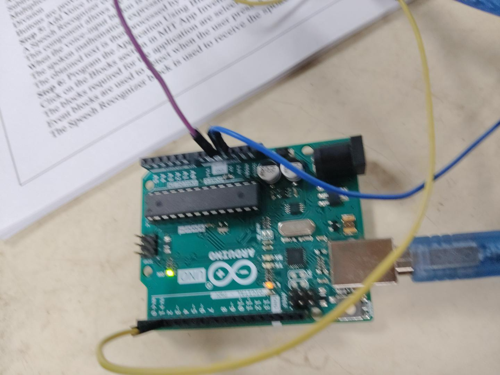

# Arduino Weather Monitoring System

## About
This project measures temperature and humidity using
an Arduino board and a DHT11 sensor.

## Components
- Arduino board
- DHT11 temperature and humidity sensor
- USB cable and jumper wires

## Working
The DHT11 sensor reads temperature and humidity.
The Arduino receives the sensor data and displays
the readings in the Serial Monitor.

## Technologies
- Arduino
- C/C++
- DHT11 sensor

## Project Output

